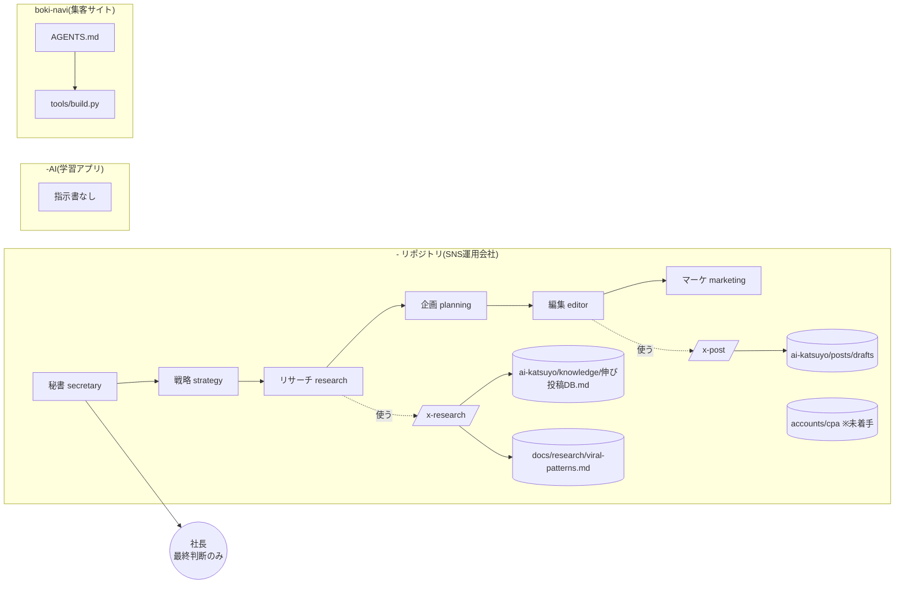

# 期間限定・上位モデル向け 作業指示書(2026-11-09 作成)

> **この文書の読み手:** 期間限定で使える上位モデル(以下「あなた」)。
> **目的:** 使える期間のうちに、**後で普段のモデルが同じ品質で回せる「資産」**(指示書・スキル・ナレッジ・チェック用スクリプト)を作り切ること。
> 日々の投稿作成のような「毎日できる作業」に期間を使わない。**一度作れば効果が残り続ける作業**に集中する。

---

## 0. 最初に必ず読むこと(読まずに着手しない)

対象リポジトリは3つ。**それぞれ別事業。混ぜない。**

| リポジトリ | 中身 | 最初に読むファイル |
|---|---|---|
| `-`(このリポジトリ) | SNS運用会社(AIエージェント6担当) | `CLAUDE.md` → `accounts/README.md` → `docs/tasks/board.md` → `.claude/agents/*` → `.claude/skills/*/SKILL.md` |
| `-AI` | 学習管理アプリ(AIチューター/テスト生成/採点。Node+Next.js) | `README.md` → `docs/scheduler.md` → `src/` → `web/` |
| `boki-navi` | 簿記・アカスク個別指導の集客サイト(Vercel静的) | `AGENTS.md` → `docs/seo-renewal.md` → `tools/build.py` |

守るルール(全作業共通):
1. **社長の仕事は最終判断だけ。** 判断が必要な所は「選択肢+推奨案」で `## 承認依頼` 形式にまとめる。オープンクエスチョン禁止。
2. **外部に出る操作はしない。** 投稿・公開・mainへのマージ・販売開始・メール送信は社長の承認後。
3. **アカウント分離(最重要)。** `-` リポジトリでは `ai-katsuyo` と `cpa` を混ぜない。作業前に対象アカウントを確定。コミットは `[ai-katsuyo]` / `[cpa]` / `[company]` で始める。
4. **事実を作らない。** 数値・実績・受講者の声・講師プロフィールを捏造しない。不明は `-` か「要確認」と書く。
5. 作業ブランチは各リポジトリとも `claude/laughing-wright-6ls4sa`。リポジトリごとにコミット・プッシュする。PRは作らない(社長が指示した場合のみ)。
6. 成果物はすべてMarkdown(またはスクリプト)でリポジトリに保存する。チャットで報告して終わりにしない。

---

## 1. 現状把握(作成時点の診断)

### `-`(SNS運用会社)
- 6担当(strategy / research / planning / editor / marketing / secretary)+スキル2本(`/x-post` `/x-research`)が稼働。
- **情報が古い:** `docs/tasks/board.md` の最終更新が 2026-07-05。朝7時の定例・定期リサーチは「7日で失効」運用で、現在動いているか不明。`daily-routine.md` は旧ブランチ名(`claude/sns-operations-company-uqffmu`)を参照している。
- **ナレッジが薄い:** `accounts/ai-katsuyo/knowledge/` の4ファイルは各20〜30行。伸び投稿DBに実データがほぼ無い。初投稿(2026-07-06)の反応記録が未着手。
- **CPA事業は未着手:** コンセプト・NGワード・投稿DBなし。社長インプット待ち。
- 定型作業のうち、スキル化されているのは投稿生成とリサーチだけ。朝の定例・前日分析・週次報告・ネタ出しは毎回プロンプト頼み。

### `-AI`(学習管理アプリ)
- エージェント向け指示書(`CLAUDE.md` / `AGENTS.md`)が**無い**。
- コミット履歴が `f` `z` `h` など意味のないメッセージで、変更意図を追えない。
- `npm run lint` が `node -c src/*.ts || true`(常に成功する=実質チェックなし)。テストも無い。
- OpenAI と Gemini の両SDKが依存に入っており、どちらが正なのか文書化されていない。

### `boki-navi`(集客サイト)
- `AGENTS.md` は充実している(料金・景表法・SEO・ビルド手順)。
- ただし**料金は8箇所以上を手で一致させる運用**で、ズレを検出する仕組みが無い。FAQ本文とJSON-LDの一致も目視頼み。
- 次の施策(コラム記事でのトピッククラスター)は未着手。

---

## 2. やること(優先順。上から順に終わらせる)

期間がいつ終わっても価値が残るよう、**P0 → P1 → P2 の順**で、各タスクを「完了 → コミット → プッシュ」してから次へ進む。途中で期間が切れても半端な状態を残さない。

### P0-1. スキル図(全体マップ)を作る
**成果物:** `-/docs/strategy/skill-map.md`

- 3リポジトリにある「担当エージェント」「スキル」「定型ワークフロー」「指示書」をすべて棚卸しし、Mermaid図で描く。
- 図は2枚:
  1. **現状図** — 誰が(担当)・何を使って(スキル/ファイル)・何を作るか(成果物の保存先)。下の「たたき台」を実ファイルと照合して直す。
  2. **目標図** — P0〜P2を終えた後の姿。新設スキルは色を変える。
- 図の下に表で「スキル名 / 担当 / 起動方法 / 入力 / 出力先 / 読むナレッジ / 状態(稼働・新設・未着手)」を並べる。
- 抜け・重複・どの担当にも属さない作業を「ギャップ一覧」として列挙する(P0-3の材料になる)。

たたき台(現状図。照合して修正すること):



### P0-2. 「モデルが変わっても品質が落ちない」指示書を整える
**狙い:** 期間が終わった後、普段のモデルが同じ判断をできるようにする。暗黙知を文章にする。

- **`-AI/CLAUDE.md` を新規作成**(`-AI` に指示書が無いため最優先)。内容: アプリの目的、ディレクトリ地図、起動方法(`npm run server` / `npm run web`)、LLMの接続先がどれか(コードを読んで事実を書く。不明なら「要確認」)、プロンプトとZodスキーマの対応表、ガードレール(`src/prompts/guardrails.ts` の転載禁止ルール)、やってはいけないこと。
- **`boki-navi/CLAUDE.md` を新規作成** — 中身は「`AGENTS.md` を正とする」と書いて参照させるだけ(二重管理を避ける)。
- **`-/CLAUDE.md` と各 `.claude/agents/*.md` を見直す** — 現行の内容を壊さず、次を追記:
  - 「判断に迷ったときの優先順位」(例: 分離ルール > 事実性 > NGワード > 伸びる型)
  - 担当ごとに「良い成果物の例」1つと「ダメな成果物の例」1つ(なぜダメかを添えて)。後のモデルが真似できる見本にする。
- `docs/tasks/daily-routine.md` の旧ブランチ名など、**古くなった記述を直す**。

### P0-3. 定型作業をスキル化する(`-` リポジトリ)
**成果物:** `-/.claude/skills/<name>/SKILL.md`(既存の `x-post` `x-research` と同じ書式)

新設候補(P0-1のギャップ一覧で増減してよい):

| スキル | 何をするか | 担当 |
|---|---|---|
| `/daily-brief` | 朝の定例(前日分析+リサーチ要約+本日3案)を1コマンドで。`daily-routine.md` をスキル化 | secretary |
| `/post-review` | 社長が貼った数値(表示・いいね・ブクマ)から投稿を分析し、伸び投稿DBに記録 | research |
| `/idea-batch` | ネタ20本出し → 推奨トップ5 → `planning/idea-stock.md` に追記 | planning |
| `/weekly-report` | タスクボードと週の成果から週次報告を作る | secretary |
| `/account-setup` | 新アカウント(CPA等)の knowledge 4ファイルを、社長への選択式質問から作る | strategy |

各スキルに必ず入れるもの:
- 冒頭で**対象アカウントを確定する手順**(曖昧なら選択肢で確認)
- 読むファイル一覧と、**他アカウントのファイルを読まない**旨
- 出力フォーマット(コピペできる形)と保存先
- 最後のセルフチェック項目(NGワード照合・事実性・字数)

### P0-4. 現状のタスクボードを最新化する
- `docs/tasks/board.md` を読み、2026-07-05以降の実態とズレている所を洗い出す。**事実が分からない項目は推測で埋めず、承認依頼にまとめる**(例: 定例は今も動いているか / 初投稿の数値)。
- 最終更新日を更新し、本指示書のタスクを「進行中」に載せる。

### P1-1. ai-katsuyo のナレッジを厚くする
- `docs/research/viral-patterns.md`(型カタログ)を、型ごとに「構造の分解・効く理由・使いどころ・避けるべき場面・見本1本」まで書き込む。見本は公開Web上で確認できた事例の要約のみ(Xへのログイン・スクレイピング禁止)。
- `accounts/ai-katsuyo/knowledge/` の4ファイルを見直し、`/x-post` が迷う所(口調の境界、使ってよい誇張の程度など)を具体例で埋める。
- **見本投稿集(ゴールデンサンプル)** を `accounts/ai-katsuyo/knowledge/見本投稿.md` に10本作る。型ごとに「良い例/惜しい例/その差」。今後のモデルの手本になる。

### P1-2. boki-navi に自動チェックを入れる
**成果物:** `boki-navi/tools/check.py`(標準ライブラリのみ)

- 料金: `assets/site.js` の `PRICES` を正として、`AGENTS.md` に列挙された全箇所の金額が一致するか検査。
- FAQ: 表示中の `<details>` と JSON-LD の FAQPage の文面が一致するか検査。
- SEO: title / description の重複、H1が1つか、sitemap に noindex ページが入っていないか。
- 禁止表現: 「必ず合格」「No.1」「最短」など景表法NG表現の検出。
- `python3 tools/check.py` でFAILが0になることを確認し、`AGENTS.md` の「作業の進め方」に実行手順を1行追記する。

### P1-3. -AI の健康診断
**成果物:** `-AI/docs/audit-2026-11.md`

- 動くかどうかを実際に確認(`npm i` → 型チェック `npx tsc --noEmit`)。結果をそのまま書く。
- 技術的負債の一覧(重要度順): 形だけのlint、テスト無し、LLM SDKの二重依存、`data/*.json` を本番データとして使っていないか、APIキーの扱い など。
- 「すぐ直せる小さな修正」(例: lintを実際に動く形にする)は修正まで行う。**大きな設計変更は修正せず、選択肢+推奨案で承認依頼に回す。**

### P2-1. boki-navi のコラム企画(SEO)
- 「簿記2級 独学 つまずく論点」系のトピッククラスターを設計し、記事10本分の構成案(狙うキーワード・見出し・内部リンク先)を `boki-navi/docs/column-plan.md` に作る。**本文の公開はしない。**

### P2-2. CPA事業の立ち上げ準備
- `accounts/cpa/README.md` の「着手前に必要な社長インプット」3点を、**選択肢+推奨案の質問票**にして `accounts/cpa/planning/setup-questions.md` に保存。
- 社長が答えたら `/account-setup` でknowledge 4ファイルを作る。**ai-katsuyo の資料は一切読まない・流用しない。**
- 注意: boki-navi(簿記・アカスク指導)とCPA事業が同じ事業かどうかは**決まっていない**。勝手に結びつけず、質問票の1項目として社長に確認する。

### 最後に必ず: 引き継ぎ書
**成果物:** `-/docs/tasks/handoff-after-premium-sprint.md`

- やったこと / やり残したこと(優先順)/ 社長の承認待ち一覧
- 普段のモデルで回すときの「1日の回し方」(どのスキルをどの順で使うか)
- 期間中に気づいた、指示書にまだ書けていない注意点

---

## 3. 進め方の約束

- 各タスクは **作る → 自分で読み返して検証 → コミット → プッシュ** の順で閉じる。検証できなかった点は「未検証」と明記する。
- 社長への確認は作業の途中で細切れに出さず、**タスクの区切りでまとめて**出す。確認待ちの間は、他の確認不要なタスクを進める。
- スキルや指示書を書いたら、そのスキルを**1回試走**させ、出力が指示どおりかを確認してから完了にする(試走結果は投稿しない)。
- 既存ファイルの大幅な書き換えは避け、追記・修正で済ませる。消す場合は理由をコミットメッセージに書く。

---

## 4. 社長への提示フォーマット(全タスク共通)

```
## 承認依頼
- 案A: ...(推奨 — 理由)
- 案B: ...
- 案C: ...
→ どれにしますか?(A/B/C または修正指示)
```

## 5. 完了の定義

- [ ] P0-1〜P0-4 がすべてコミット・プッシュ済み
- [ ] 新設スキルが各1回試走され、結果が確認されている
- [ ] `boki-navi/tools/check.py` が FAIL 0
- [ ] 引き継ぎ書があり、承認待ちが1箇所にまとまっている
